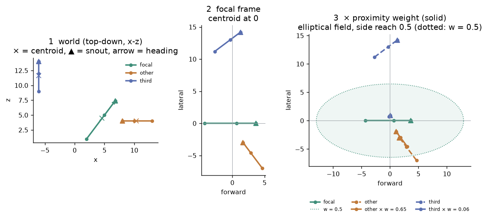
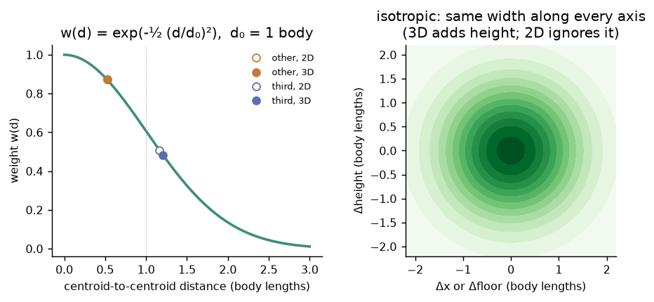
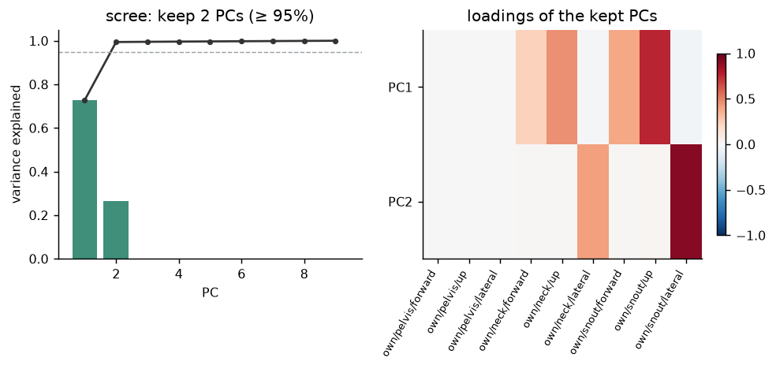
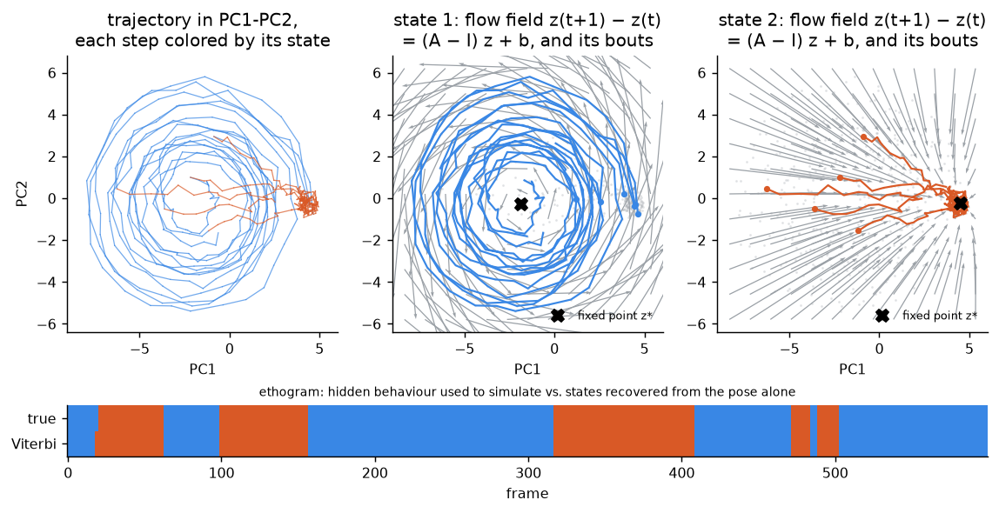
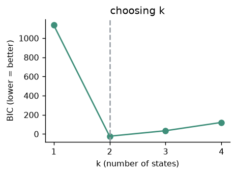

# etho: pose viewer and behaviour analysis

etho turns tracked animal poses (anything from one 2D centroid to groups of 3D skeletons) into
**behavioural states**. It first builds egocentric and social features, then reduces them with
PCA, and finally fits a **switching linear dynamical system**. In that model each state is a
*flow field*: a rule for how the pose moves from one frame to the next. The whole pipeline runs
in the browser in [`viewer/pose_viewer.html`](viewer/pose_viewer.html). Open the file (or the
**[hosted viewer](https://daveandhismice.github.io/etho/viewer/pose_viewer.html)**), click **Load data…**,
then open the **Clustering** tab.

This README explains the method step by step. Each step has a schematic and a worked example on
toy data. All of the toy numbers and figures come from
[`docs/toy_pipeline.py`](docs/toy_pipeline.py), which repeats the viewer's maths in about 400
lines of numpy. Run it to reproduce them (see [Reproducing the examples](#reproducing-the-examples)).

```
repo
├── viewer/
│   ├── pose_viewer.html        the app (built: open it in a browser)
│   ├── viewer_template.html    its source; the whole analysis lives here
│   ├── pose_format.js          etho-pose loader / validator      (spec: POSE_FORMAT.md)
│   ├── report_pdf.js           PDF report export
│   ├── analysis_notebook.py    notebook export (Python version of the summaries)
│   ├── CLUSTER_FORMAT.md       spec of the clusters export
│   └── build_viewer.py         template + js + notebook → pose_viewer.html
├── generate_*.py               synthetic test datasets (mouse_*.json, skeleton_dataset.json)
└── docs/toy_pipeline.py        the worked examples and figures in this README
```

---

## Contents

0. [The pipeline at a glance](#0-the-pipeline-at-a-glance)
1. [Input data](#1-input-data)
2. [Preparing the pose: axes and gap filling](#2-preparing-the-pose-axes-and-gap-filling)
3. [Centroid and heading](#3-centroid-and-heading)
4. [Egocentric pose (the "ego" feature set)](#4-egocentric-pose-the-ego-feature-set)
5. [Social features (the "social" feature set)](#5-social-features-the-social-feature-set)
6. [Node removal and the feature matrix](#6-node-removal-and-the-feature-matrix)
7. [Dimensionality reduction: PCA](#7-dimensionality-reduction-pca)
8. [Flow fields: switching linear dynamics](#8-flow-fields-switching-linear-dynamics)
9. [Fitting the model: EM](#9-fitting-the-model-em)
10. [Clustering: states, choosing k, bouts](#10-clustering-states-choosing-k-bouts)
11. [What you get out](#11-what-you-get-out)
12. [Parameter reference](#12-parameter-reference)

---

## 0. The pipeline at a glance

```
 etho-pose JSON                       one sample = one animal in one frame
 (animals × frames × joints × xyz)
        │
        ▼
 ┌──────────────────────┐   axes → Y up, 2D → floor plane,
 │ 2  prepare           │   missing joints (null) linearly interpolated
 └──────────┬───────────┘
            ▼
 ┌──────────────────────┐   centroid c = mean of joints (on the floor)
 │ 3  centroid, heading │   heading θ = direction posterior → anterior node
 └──────────┬───────────┘
            ▼
 ┌──────────────────────┐   every joint in the animal's own frame:
 │ 4  egocentric pose   │   (forward, up, lateral), centroid at the origin
 └──────────┬───────────┘
            ▼   (social only)
 ┌──────────────────────┐   every other animal in the focal frame,
 │ 5  social block      │   nearest first, rotated onto the body axis,
 │                      │   × w(d) = exp(−½ (d/d₀)²),  d = centroid distance in 2D or 3D
 └──────────┬───────────┘
            ▼
 ┌──────────────────────┐   rows = animal × frame, columns = features
 │ 6  feature matrix X  │   (removed nodes zeroed)
 └──────────┬───────────┘
            ▼
 ┌──────────────────────┐   keep the PCs that reach 95% of the variance
 │ 7  PCA               │   → z(t), a few numbers per frame
 └──────────┬───────────┘
            ▼
 ┌──────────────────────┐   state s(t) ∈ {1..k} switches by a sticky Markov chain;
 │ 8  switching linear  │   inside state c:  z(t+1) = A_c z(t) + b_c + noise
 │    dynamics          │   (one affine flow field per state)
 └──────────┬───────────┘
            ▼
 ┌──────────────────────┐   EM fit for k = 2..15, keep the lowest BIC;
 │ 9-10 EM, BIC, Viterbi│   Viterbi path = one state label per frame per animal
 └──────────┬───────────┘
            ▼
   ethogram · bouts · flow-field plots · prototypes · JSON/CSV/PDF/notebook
```

The design rests on three ideas:

* **Everything is measured from the animal's own point of view.** Where the animal is in the arena
  and which way it faces are removed. Only posture remains, plus, in the social set, where the
  others are relative to it.
* **States are dynamics, not snapshots.** A state is not defined by a typical pose. It is a typical
  *way of moving*: spiralling, settling into a pose, drifting. The same pose can belong to two
  states if it is moving differently.
* **All animals share one model.** Every animal's frames are stacked into one dataset. State 3 means
  the same thing for mouse 1 and mouse 4.

---

## 1. Input data

The viewer reads **etho-pose 1.0** JSON (full spec: [`viewer/POSE_FORMAT.md`](viewer/POSE_FORMAT.md)).
It also accepts the older `pose-testset` files. Toy example: two animals, a 3-joint skeleton,
3 frames, one missing joint and one missing frame:

```jsonc
{
  "format": "etho-pose", "version": "1.0",
  "space": { "dims": 3, "units": "cm", "up": "+Y" },
  "skeletons": { "mouse": { "joints": [
      { "name": "pelvis", "parent": null },
      { "name": "neck",   "parent": 0 },
      { "name": "snout",  "parent": 1 } ],
    "bones": [[0, 1], [1, 2]] } },
  "animals": [ { "id": "m1", "skeleton": "mouse" }, { "id": "m2", "skeleton": "mouse" } ],
  "clips": [ { "name": "toy", "fps": 30, "frame_count": 3, "tracks": {
      "m1": { "positions": [ [[2,1.5,1],[5,2,5],[6.8,1,7.4]],
                             [[2,1.5,1],[5,2,5],null],          // one joint missing
                             [[2,1.5,1],[5,2,5],[6.9,1,7.5]] ] },
      "m2": { "positions": [ [[13,1.5,4],[10,2,4],[8,1.2,4]],
                             null,                               // whole frame missing
                             [[13,1.5,4],[10,2,4],[8,1.2,4]] ] } } } ]
}
```

Every animal in a clip must share one skeleton, because the features compare animals joint by joint.

---

## 2. Preparing the pose: axes and gap filling

**Axes.** Every coordinate is converted to the viewer's frame: **x and z span the floor, y is up**.
A `"+Z"`-up file is rotated. A 2D file's `(x, y)` is placed on the floor as `(x, 0, y)`.

**Gaps.** Each missing sample (`null`) is filled per joint and per coordinate. Gaps between
two known frames are interpolated linearly. Gaps before the first or after the last known
frame are held at that frame's value. The viewer reports how many samples it filled. If a joint
is never seen in a clip, the viewer stops with an error.

```
 known:    ●───────────────────●                 (frames 1 and 4)
 frame:    0     1     2     3     4     5
 filled:   ◌═════●─────◌─────◌─────●═════◌        ═ held flat   ─ linear
```

Toy example: the snout of one animal over 6 frames, `(x, y, z)` in cm.

| frame | raw | filled | how |
|---|---|---|---|
| 0 | `null` | (6.0, 1.0, 7.0) | held: before the first known frame |
| 1 | (6.0, 1.0, 7.0) | (6.0, 1.0, 7.0) | known |
| 2 | `null` | (7.0, 1.0, 6.0) | ⅓ of the way from frame 1 to frame 4 |
| 3 | `null` | (8.0, 1.0, 5.0) | ⅔ of the way |
| 4 | (9.0, 1.0, 4.0) | (9.0, 1.0, 4.0) | known |
| 5 | `null` | (9.0, 1.0, 4.0) | held: after the last known frame |

> Interpolation fills a short dropout well. A long one becomes a straight-line glide, which the
> dynamics model will treat as real (smooth, slow) movement. Watch the fill count the viewer reports.

---

## 3. Centroid and heading

For every animal and frame:

```
 centroid   c = mean over joints of (x, z),  placed on the floor (y = 0)
 height     h = mean over joints of y        (used only by the 3D proximity distance)
 heading    θ = atan2(z_ant − z_post, x_ant − x_post)
```

The **body axis** runs from a posterior to an anterior node. The viewer picks the first name it
finds in these lists:

| role | names tried, in order |
|---|---|
| anterior | `neck`, `chest`, `spine_mid`, `head`, `snout`, `nose` |
| posterior | `pelvis`, `tail_base`, `hips` |

If neither is found, it uses the first node and the node farthest from it in frame 1. The axis
nodes are named in the exports (`egocentric_axis`).

Toy scene: three 3-joint mice, one frame, in cm. "third" is standing on a 3.5 cm block.

| animal | pelvis | neck | snout | centroid (x, z) | mean height | heading θ |
|---|---|---|---|---|---|---|
| focal | (2, 1.5, 1) | (5, 2, 5) | (6.8, 1, 7.4) | (4.60, 4.47) | 1.50 | 53.1° |
| other | (13, 1.5, 4) | (10, 2, 4) | (8, 1.2, 4) | (10.33, 4.00) | 1.57 | 180.0° |
| third | (−6, 5, 9) | (−6, 5.5, 12) | (−6, 4.5, 14) | (−6.00, 11.67) | 5.00 | 90.0° |

For the focal animal, pelvis → neck is (3, 4), so cos θ = 0.6, sin θ = 0.8 and θ = 53.1°.

---

## 4. Egocentric pose (the "ego" feature set)

Each joint `q` of an animal is re-expressed in that animal's own frame. The centroid is the
origin, and the heading points along +forward:

```
 forward  =  (q_x − c_x)·cos θ + (q_z − c_z)·sin θ
 lateral  = −(q_x − c_x)·sin θ + (q_z − c_z)·cos θ
 up       =   q_y                     (3D only: height above the floor, kept as is)
```

```
        world (top-down)                         egocentric
   z                                          lateral
   ▲         ▲ snout                             ▲
   │        ╱                                    │
   │   neck●                                     │
   │      ╱   θ                     ●────────●───┼──▲──────▶ forward
   │  ×  ╱ ) ─── heading            pelvis   neck│ snout
   │  pelvis                                     │
   └───────────────▶ x                 (centroid at the origin, facing +forward)
```

Toy example, focal animal (from the table above). Per joint, (forward, up, lateral):

| joint | forward | up | lateral |
|---|---|---|---|
| pelvis | −4.33 | 1.5 | 0.00 |
| neck | 0.67 | 2.0 | 0.00 |
| snout | 3.67 | 1.0 | 0.00 |

**Ego feature vector** for this frame, ordered joint by joint, then axis by axis
(J joints × 3 axes = 9 numbers):

```
 own/pelvis/forward  own/pelvis/up  own/pelvis/lateral  own/neck/forward  …  own/snout/lateral
 [   −4.33              1.5             0.00              0.67            …       0.00      ]
```

A straight mouse has every lateral value at 0. Lateral values move away from zero when the body
bends, and the up values change when the animal rears or climbs. 2D data has
`(forward, lateral)` only, so 2 numbers per joint.

---

## 5. Social features (the "social" feature set)

The social set takes the focal animal's own 9 numbers and appends a block for **every other
animal**, measured in the **focal animal's frame**. Three steps shape each block.

```
  per frame, per focal animal:

  [ own block: J×3 ] [ other1: J×3 ] [ other2: J×3 ] …     (A animals → A blocks)
                       ▲ nearest       ▲ next nearest
                       │
          ┌────────────┴──────────────────────────────────────────────┐
          │ a) every joint of that animal → focal frame (same formulas)│
          │ b) rotate about the focal centroid onto the body axis      │
          │ c) multiply the whole block by w(d) = exp(−½ (d/d₀)²)      │
          └────────────────────────────────────────────────────────────┘
```

**a) Nearest first.** The other animals are sorted by centroid distance in each frame. Slot
`other1` always holds the nearest animal, so a column means the same thing ("the closest
neighbour's snout") for every animal and every frame, whoever that neighbour is.

**b) Rotation onto the body axis** (optional, on by default). The other animal's direction from
the focal centroid is its **bearing** φ. Every joint of the other animal is rotated about the
focal centroid by the smallest angle that puts it on the forward axis. An animal in front stays
in front, one behind stays behind (φ is wrapped into (−90°, 90°]), and the distance is unchanged.
This throws away only **which side** (left or right) the other animal is on. That is usually
irrelevant, and keeping it would split one behaviour into mirrored copies. What remains is the
distance, front or behind, and the other animal's posture and orientation relative to the line
between the two.

**c) Proximity weight.** The whole block is multiplied by an **isotropic Gaussian centred on the
focal centroid and read at the other animal's centroid**:

```
 w(d) = exp( −½ (d / d₀)² )

 d  = centroid-to-centroid distance in that frame
      3D:  d = √(Δx² + Δz² + Δh²)   (Δh = difference in mean height; default for 3D data)
      2D:  d = √(Δx² + Δz²)         (floor only; the only option for 2D data)
 d₀ = width, in body lengths (nose-to-tail extent of animal 1 in frame 1), the same on every axis
```

A distant animal shrinks toward 0, which reads as "nobody nearby". It doesn't leave sharp
patterns in the features that don't mean anything. The same distance (2D or 3D) is used for the
nearest-first ordering. The 3D distance separates an animal on a block above the focal animal
from one beside it on the floor.



*Left: the toy scene from above. Middle: the same scene in the focal animal's frame. Right: each
other animal rotated onto the focal body axis (dashed), then scaled by its weight (solid). "other"
is in front, "third" is behind.*

Toy example (body length 11 cm, d₀ = 1 body):

| slot | animal | d (2D) | d (3D) | w (2D) | w (3D) | bearing φ | rotation | side |
|---|---|---|---|---|---|---|---|---|
| other1 | other | 5.75 | 5.75 | 0.872 | 0.872 | −57.8° | +57.8° | in front |
| other2 | third (on a block) | 12.81 | **13.28** | 0.507 | **0.482** | 92.7° | +87.3° | behind |

The third mouse's 3.5 cm of extra height makes it farther away in 3D, so its weight is lower.
Its bearing is 92.7°, past 90°, so it is rotated onto the *rear* of the axis.

The "other" animal's block, joint by joint, as (forward, up, lateral):

| joint | in the focal frame | rotated onto the axis | × w = 0.872 (final features) |
|---|---|---|---|
| pelvis | (4.67, 1.5, −7.00) | (8.41, 1.5, 0.22) | (7.34, 1.31, 0.19) |
| neck | (2.87, 2.0, −4.60) | (5.42, 2.0, −0.03) | (4.73, 1.74, −0.02) |
| snout | (1.67, 1.2, −3.00) | (3.43, 1.2, −0.19) | (2.99, 1.05, −0.17) |

After the rotation, the other animal lies along the focal axis with its snout 3.4 cm ahead of the
focal centroid, facing back toward it. This is the signature of an approach.



*Left: the weight against distance, with the two toy animals marked (hollow = 2D, filled = 3D).
Right: the kernel is isotropic, with the same width along the floor and in height.*

In the viewer the Weights panel shows these settings live. It draws the w(d) curve over a
histogram of this clip's distances, gives the share of animal pairs × frames with weight > 0.5,
and gives the share of input variance from the animal's own pose versus the others.

---

## 6. Node removal and the feature matrix

In the Weights panel you can **untick nodes** (e.g. a noisy tail tip). A removed node's
columns are set to zero in every block, own and other, so it adds nothing to the analysis. The
body axis is still defined by the same nodes.

All animals' frames are then stacked into **one matrix**, animal by animal:

```
                  features →  own block │ other1 │ other2 │ …       (ego: own block only)
               ┌──────────────────────────────────────────────┐
  animal 1  f0 │                                              │
            f1 │                                              │
            …  │              X   (A·T rows × D columns)      │
  animal 2  f0 │                                              │
            …  │                                              │
               └──────────────────────────────────────────────┘
      D = J × axes                (ego)
      D = J × axes × A            (social, A animals)
```

The four-mouse example dataset (18 joints, 3D, 60 s at 30 fps) gives 54 ego or 216 social
features per sample, over 7,200 samples.

All features are positions in the dataset's own length unit. Nothing is z-scored, so a joint
that moves a lot carries more variance than one that barely moves. That is deliberate, because
a big movement should matter more than tracking jitter on a still joint.

---

## 7. Dimensionality reduction: PCA

PCA finds the few directions in feature space along which the pose actually varies:

```
 1. centre:     X̃ = X − mean(X)                     (per column)
 2. covariance: C = X̃ᵀX̃ / (n − 1)                  (D × D)   — or the n × n Gram matrix X̃X̃ᵀ
                                                               when there are more features than samples
 3. eigen:      C v_k = λ_k v_k,   λ₁ ≥ λ₂ ≥ …       (exact Jacobi up to 120×120,
                                                     else subspace iteration)
 4. keep:       the first n PCs with  Σ_{k≤n} λ_k / Σ λ ≥ 95%
 5. scores:     z(t) = X̃(t) · [v₁ … v_n]            → n numbers per sample
```

Each eigenvector's sign is fixed so that its largest entry is positive, which makes reruns give
identical results. The kept scores `z(t)` are the input to the dynamics model. The PC1–PC3 plot,
the PCA reconstruction ("ghost" skeleton) and the exported loadings all come from the same
decomposition.

**Toy example.** 600 frames of the toy mouse's 9 ego features. The snout and neck move along two
hidden coordinates: *rearing* (up and forward) and *scanning* (side to side). Tracking noise is
added on top.

```
 variance per PC : 0.73  0.27  0.00  0.00 …
 cumulative      : 0.73  0.99  …            → keep 2 PCs (first to reach 95%)
 PC1 strongest   : own/snout/up +0.77, own/neck/up +0.46, own/snout/forward +0.38   ("rear")
 PC2 strongest   : own/snout/lateral +0.91, own/neck/lateral +0.41                  ("scan")
```



PCA recovers the two hidden movements as PC1 and PC2. The noise ends up in the discarded PCs.

> Option: *Reduction → None* runs the dynamics on the centred raw features (constant columns
> dropped) with stronger regularisation. PCA is then used only for the plots.

---

## 8. Flow fields: switching linear dynamics

Clustering is done on **how z(t) moves**, not where it sits. The model is an autoregressive
hidden Markov model, also called a switching linear dynamical system:

```
 hidden state      s(t) ∈ {1, …, k}            P(s(t+1)=j | s(t)=i) = P_ij   (sticky: P_ii large)

 dynamics          z(t+1) = A_s z(t) + b_s + ε,   ε ~ N(0, Σ_s)

        s(t) ──▶ s(t+1) ──▶ s(t+2) ──▶ …         hidden behaviour
          │         │          │
          ▼         ▼          ▼
        z(t) ──▶ z(t+1) ──▶ z(t+2) ──▶ …         observed PC scores
             A_s,b_s    A_s,b_s
```

Each state's `(A, b)` is an **affine flow field**. At any point z it predicts the next step
`Δz = (A − I) z + b`. The eigenvalues of A and the fixed point show what kind of movement the
state is:

| eigenvalues of A | movement | example |
|---|---|---|
| real, \|λ\| < 1 | decays straight to the fixed point z* = (I − A)⁻¹ b | settling into a pose (rearing up and holding) |
| complex, \|λ\| ≈ 1 | rotates around z*, at angle(λ) per frame | rhythmic movement: scanning, grooming, gait |
| complex, \|λ\| < 1 | spirals in | a dampening oscillation |
| \|λ\| ≈ 1, real | drifts: no restoring force | slow wandering through poses |

```
   decay to a fixed point            rotation (spiral)
      ↘  ↓  ↙                          ↗ → ↘
      →  ⊗  ←                          ↑ ⊗ ↓
      ↗  ↑  ↖                          ↖ ← ↙
```

Each frame-to-frame pair is a **transition**. A frame's label is the state of the transition
leaving it. In a non-looping clip the last frame copies the label before it. Transitions never
cross from one animal's sequence to the next.

**Toy example.** The 600 toy frames were simulated with two behaviours. One is "scanning", a slow
spiral (rotation 0.25 rad = 14.3° per frame, |λ| = 0.985). The other is "rearing", which decays
toward a raised pose (A = 0.9 I). They switch with a sticky chain. The fit, from the PC scores
alone, recovers both:

| state | fitted A | eigenvalues | reading | fixed point z* |
|---|---|---|---|---|
| 1 | `[[0.95, −0.27], [0.23, 0.95]]` | 0.95 ± 0.25i (\|λ\| = 0.99) | rotation, 14.4°/frame | (−1.87, −0.30) |
| 2 | `[[0.89, −0.02], [−0.01, 0.88]]` | 0.90, 0.87 | decay | (4.53, −0.27): high PC1 = reared |



*Left: the whole trajectory in PC1–PC2, each step coloured by its fitted state. Middle and right:
each state's flow field (grey arrows), its longest bouts (coloured, dot = start) and its fixed
point (✕). Bottom: the true behaviour used to simulate the data against the Viterbi states
recovered from the pose (99.7% agreement).*

The viewer draws the same panels in its *Flow fields by state* section. Arrows show the fitted
field on PC1–PC2, with the other PCs held at the state's mean.

---

## 9. Fitting the model: EM

```
 initialise ── k-means++ (10 restarts) on [z(t), Δz(t)], each half scaled to unit RMS
     │          → hard state guesses; P starts at 0.9 on the diagonal, π uniform
     ▼
 ┌─▶ M-step  for each state c, with weights r_c(t) = P(s(t) = c | data):
 │            [A_c | b_c] = weighted least squares of z(t+1) on [z(t), 1]   (+ tiny ridge)
 │            Σ_c         = weighted covariance of the residuals          (+ noise floor)
 │            P_ij        ∝ expected i→j counts + κ·[i = j] + 0.001       (sticky)
 │            π           ∝ expected first-step state + 0.001
 │   E-step  forward–backward on each animal's sequence (scaled) with Gaussian
 │            emissions N(z(t+1); A_c z(t) + b_c, Σ_c) → new r_c(t), log-likelihood
 └── until |Δ log L| < 1e-5 · |log L|  or 80 iterations (setting: EM iterations)
     ▼
 Viterbi   most likely single state path per animal → labels
```

Details that matter in practice:

* **Stickiness.** κ = stickiness × (number of transitions) / k is added to each state's
  self-transition count. Default stickiness 0.1. Higher values give fewer, longer bouts, and
  0 gives a plain HMM.
* **Regularisation.** There is a ridge of 10⁻⁸ × trace on the least-squares Gram matrix, and a
  noise floor of 10⁻⁴ × mean step variance on Σ. A state that collects fewer than m + 2
  transitions of weight collapses to identity dynamics with the global step variance, so it
  cannot blow up.
* **Deterministic.** The k-means initialisation is seeded and the eigenvector signs are fixed, so
  the same data and settings always give the same states.

---

## 10. Clustering: states, choosing k, bouts

**Choosing k.** The model is fitted for every k in the range (default 2–15). The viewer keeps the
fit with the lowest **BIC**:

```
 BIC = −2 log L + p · ln N            N = number of transitions (frame pairs)

 p   = k · [ m(m+1)      (A and b)
           + m(m+1)/2 ]  (Σ, symmetric)
     + k(k−1)            (transition matrix)
     + (k−1)             (initial distribution)          m = number of kept PCs
```

Toy example (m = 2):

| k | log L | parameters p | BIC |
|---|---|---|---|
| 1 | −539.6 | 9 | 1136.8 |
| **2** | **78.6** | **21** | **−22.9** ← chosen |
| 3 | 94.8 | 35 | 34.2 |
| 4 | 102.6 | 51 | 120.9 |



Going from 1 to 2 states increases the likelihood enormously. Extra states add a little more
likelihood but cost more than they gain. Every fit is kept, so clicking another k in the viewer's
BIC plot switches to it at once.

**Labels and bouts.**

```
 Viterbi path      1 1 1 1 2 2 2 2 2 2 1 1 1 …
 bouts             └─1──┘ └────2────┘ └─1── …       a bout = a run of one state
                                                    (runs restart at each animal)
```

States are renumbered in order of first appearance, so state 1 is whatever happens first. For
each state the viewer reports its share of time, number of bouts and mean bout length. In the
toy example the 600 frames split into 11 bouts, with a mean of 54.5 frames.

**Prototypes.** For each state the viewer finds the bouts whose frames lie nearest the state's
mean in PC space (up to ±1.5 s around the frame). It animates them in the animal's own frame,
with the other animals in grey for social runs. These are real frames, not reconstructions.

---

## 11. What you get out

| output | content |
|---|---|
| **timeline (CL rows)** | each animal's state per frame, under the playback |
| **PC1–PC3 plot, scree** | every sample in PC space coloured by state; variance per PC |
| **flow fields by state** | the fitted field, bouts and fixed point of each state (section 8) |
| **prototypes** | real example bouts of each state |
| **reconstruction ghost** | the skeleton rebuilt from the first q PCs, over or beside the original |
| **Clusters (.json)** | `etho-clusters` 1.0: labels, bouts, PC scores, model (A, b, Σ, P, fixed points), PCA loadings, feature settings including the proximity kernel ([spec](viewer/CLUSTER_FORMAT.md)) |
| **Labels (.csv)** | `animal_id, animal, frame, time_s, state` |
| **Summary report (.pdf)** | ethogram, time budget, bouts, transitions, PCA, per-state movement and social measures, average poses, a plain-language summary per state |
| **Analysis notebook (.zip)** | the same summaries as a Jupyter notebook, with the clusters and pose files beside it |

---

## 12. Parameter reference

| setting | where | default | effect |
|---|---|---|---|
| Feature set | Clustering → Input features | Ego | Ego = own pose only; Social adds every other animal |
| Nodes | Weights | all on | unticked nodes are dropped from every block |
| Rotate other animals onto the axis | Weights (social) | on | drops left/right of the other animal, keeps distance and front/behind |
| Proximity weighting | Weights (social) | on | multiply each other-animal block by w(d) |
| Distance | Weights (social, 3D data) | 3D | centroid distance with height (3D) or on the floor (2D); used for w(d) and ordering |
| d₀ | Weights (social) | 1 body length | width of the Gaussian, the same along every axis |
| Reduction | Clustering | PCA, 95% variance | or None: dynamics on raw features |
| k from / to | Clustering | 2 / 15 | range searched; lowest BIC wins |
| Stickiness | Clustering | 0.1 | self-transition pseudo-count, as a fraction of transitions per state |
| EM iterations | Clustering | 80 | maximum per fit (stops earlier on convergence) |

---

## Reproducing the examples

```bash
python docs/toy_pipeline.py        # needs numpy and matplotlib
```

The script prints every table in this README and redraws `docs/figures/*.png`. Its functions
mirror the viewer's: `fill_gaps` ↔ `fillGaps`, `ego` ↔ `egocentricFeatures`, the social block ↔
`buildFeatures`, the eigen-decomposition ↔ `runPCA`, and `arhmm` ↔ `arhmm` (same model, k-means start on
`[z, Δz]`, sticky counts, regularisation, Viterbi and BIC; the toy uses a single random k-means
start where the viewer uses k-means++ with 10 restarts).

To try the full pipeline on data that has the behaviours built in, load one of the synthetic
datasets in the viewer:

| file | what is in it |
|---|---|
| `mouse_3d.json`, `mouse_3d_large.json` | one mouse: running, rearing, grooming, stretched attend |
| `mouse_social.json` | two mice: investigating, fighting, chasing |
| `mouse_group_blocks.json` | four mice in an open field with blocks: 11 kinds of interaction, climbing, noise and missing data ([generator](generate_mouse_group_dataset.py)) |
